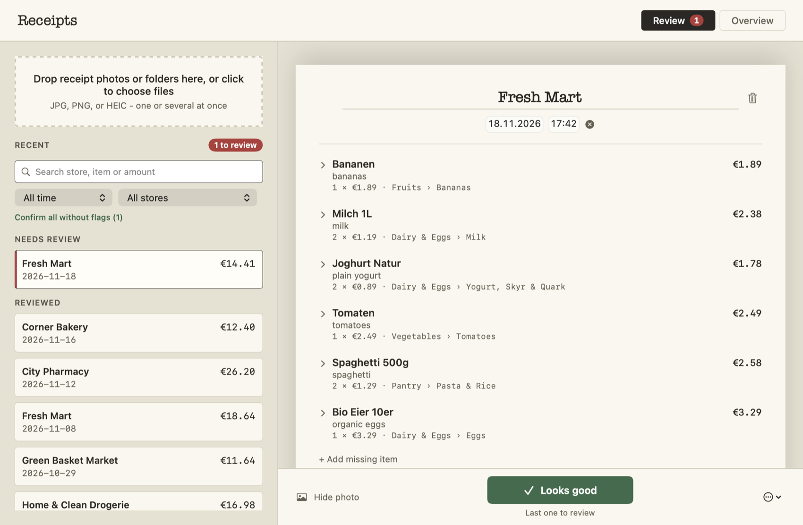
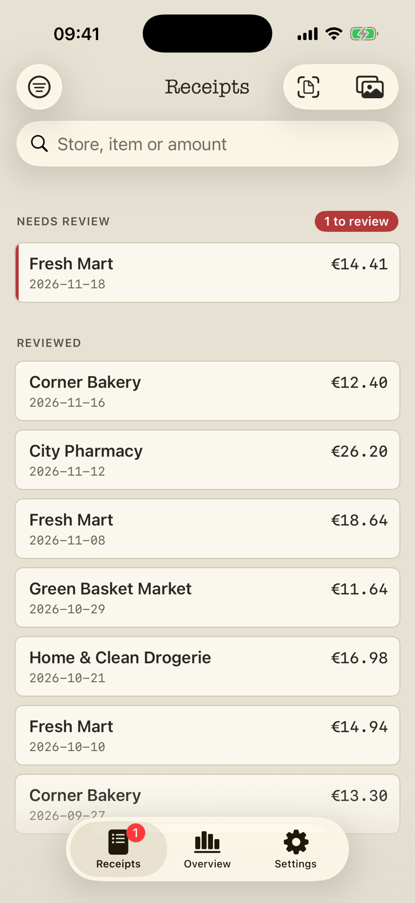

# Receipts

A receipt reader for Mac, iPhone and Android. You photograph a receipt, a vision model reads the line items,
and each item is filed under a category so you can see where the money goes. I built it because
grocery receipts are the one place my spending is recorded in detail, and nothing I tried would read
the abbreviated item names on them reliably.

## Screenshots

Both screenshots use made-up receipts from a debug-only demo data set (`Sources/ReceiptsApp/Database/DemoData.swift`).



*Mac app: the receipt list and one receipt's line items, each filed under a category.*



*iPhone app: the receipt list, with receipts still to review at the top.*

## Example

A photo of this receipt (made up):

    FRESH MART
    12.03.2026  17:42
    BANANEN          1,89
    MILCH 1L         1,19
    2 x JOGHURT      1,00
                     2,00
    SUMME            5,08

comes back from the extraction step as:

```json
{
  "store": "Fresh Mart",
  "date": "2026-03-12",
  "time": "17:42",
  "items": [
    {"raw_text": "BANANEN", "name": "Bananen", "quantity": 1, "unit_price": 1.89, "total_price": 1.89},
    {"raw_text": "MILCH 1L", "name": "Milch 1L", "quantity": 1, "unit_price": 1.19, "total_price": 1.19},
    {"raw_text": "2 x JOGHURT", "name": "Joghurt", "quantity": 2, "unit_price": 1.00, "total_price": 2.00}
  ],
  "total": 5.08,
  "printed_item_count": 3
}
```

The second step then gives every item an English translation and a path in a category taxonomy
(for example Food > Dairy > Milk). Items that fit nothing are flagged for review instead of being forced into a bad category.

## How it works

- The photo is straightened (Apple's Vision framework on Mac/iPhone, ML Kit on Android) and sent to a vision model.
- The model returns structured line items, constrained by a JSON schema. Sums and signs are checked afterwards
  (items add up to the total, a deposit return is positive, and so on); anything suspicious is marked for review.
- A second call classifies the items. Known names come from a local dictionary first, so the model is only asked about new ones.
- The backend is pluggable: the Claude API, the `claude` CLI, or a local model through Ollama, so receipts can stay on the machine.
- The extraction and classification prompts live in `backend/receipts/extraction/prompts.py` and are duplicated in Swift.
  A backend test fails if the two copies drift apart.
- The apps are offline-first and sync through a small FastAPI + SQLite server (`backend/`, API in `docs/api/receipts.md`).
  Sync is last-write-wins per record, with tombstones for deletes.

## Evaluation

I compared models and effort levels on 30 real receipts (details in `docs/decisions.md`). Haiku 5.5 at high effort read
29 of 30 exactly in every run. With the final prompts it got 218/218 prices right on the main set and 92.2% of items
in the exact category, and 96.2% on a separate set it had not been tuned on (53/53 prices). The weak spot is
receipts with text lines between the items, which shift prices against names; those are usually flagged for review.

## Running it

Backend (Python 3.12+, [uv](https://docs.astral.sh/uv/)):

    cd backend
    uv sync
    uv run pytest -q        # no network, no real model calls
    uv run alembic upgrade head && uv run uvicorn server:app --reload

Mac app: open `Receipts.xcodeproj` in Xcode and press Cmd-R, or run `swift test` for the unit tests. The default backend
uses the logged-in `claude` CLI; Settings can switch it to the API or Ollama. Cloud sync is optional.
iPhone app: pick the `ReceiptsiOS` scheme in the same project (the project is generated from `project.yml` with XcodeGen).
The Android app is described in `android/README.md`.

## Stack

SwiftUI (macOS 14+, iOS 17+) with SQLite, Kotlin with Jetpack Compose and Room, and Python with FastAPI, SQLAlchemy and
Alembic. The sync server runs in Docker (`deploy/`).
